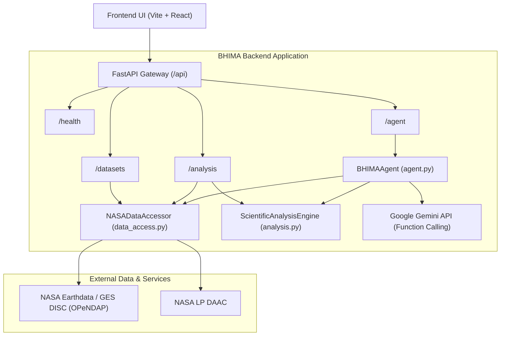

# BHIMA System Architecture

## Architecture Diagram

## Core Components

### 1. Presentation & API Layer (`app/api`)
- Built using **FastAPI 0.111.0** for asynchronous high-throughput execution.
- Configured with CORS middleware to enable seamless integration with the React/Vite frontend.
- Standardized error codes (404 for missing entities, 422 for boundary/schema validation errors, 503 for upstream data unavailability).

### 2. NASA Data Access Layer (`app/core/data_access.py`)
- Provides an abstraction layer for NASA Earthdata products.
- Uses authenticated sessions (`HTTPBasicAuth`) against NASA Earthdata URS credentials.
- Connects to NASA GES DISC OPeNDAP ASCII endpoints for remote spatial slicing of Level-3 Gridded precipitation data (`GPM_3IMERGM.07`).
- Includes a deterministic synthetic data generator when credentials are absent, ensuring developers can prototype without immediate access keys while receiving explicit warnings.

### 3. Scientific Analysis Engine (`app/core/analysis.py`)
- Implements robust non-parametric time series statistics:
  - **Hamed-Rao Modified Mann-Kendall Test**: Mitigates the risk of false positives caused by positive lag-1 autocorrelation in hydro-meteorological series.
  - **Sen's Slope Estimator**: Computes the median slope of all pairwise slopes, impervious to single-event outliers and sensor blips.
  - **Percentile Bootstrap**: Computes 95% confidence intervals over resampled time series.
  - **Descriptive Statistics**: Mean, median, standard deviation, quartiles, coefficient of variation, and valid pixel counts.

### 4. Agentic AI Research Engine (`app/core/agent.py`)
- Leverages Google Gemini Pro (`gemini-1.5-pro`) with function calling.
- Exposes structured tools to the model:
  - `get_available_datasets`
  - `get_dataset_metadata`
  - `extract_regional_timeseries`
  - `calculate_trend`
  - `compare_regions`
  - `get_analysis_sources`
- Implements an iterative tool execution loop (up to 5 turns) that supplies the agent with real computation outputs before synthesizing answers.
